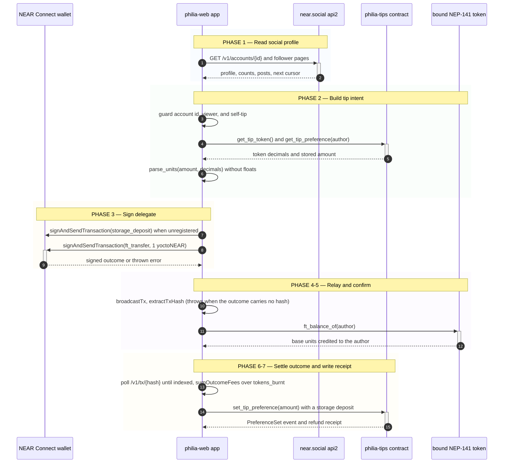

# philia

Tracks: `social`, `open` (end 2026-11-14T23:59:00Z) · License: MIT ([LICENSE](./LICENSE)) · Baseline: tag `pre-hackathon` at `c716879` (SocialENS port); diff `git diff pre-hackathon..hackathon-submission` · Q-015: the second project on the same submission email is **ekklesia** (agent market, tracks `swarms`, `agents`).

One signed transaction tips anyone on NEAR social: the wallet approves, the web app confirms, and a contract stores the preference while a bound NEP-141 token moves. Creators get paid where their audience already is, with no custody.

| Do this | See this | Proves |
|---|---|---|
| `pnpm install`; `cp .env.example web/.env.local`; `bash scripts/create-accounts.sh`; `bash scripts/deploy.sh`; `PHILIA_CONTRACT=tips.philia.testnet TIP_FT=wrap.testnet TIP_DECIMALS=24 bash scripts/deploy.sh` (Node.js >= 26.0.0, pnpm >= 12.18.0, Rust 1.100.0, `wasm32-unknown-unknown`, `cargo-near` 0.23.0, `near-cli-rs` 0.31.1, V8 14.6) | `tips.philia.testnet` deployed (`ft_account_id=wrap.testnet`, `decimals=24`); `get_tip_token()` read | quickstart works |
| `node demo/social-loop.mjs` (`ALICE_ACCOUNT=alice.philia.testnet`, `ALICE_PRIVATE_KEY`, `BOB_ACCOUNT=bob.philia.testnet`, `PHILIA_CONTRACT=philia.testnet`, `TIP_FT=3e2210e1184b45b64c8a434c0a7e7b23cc04ea7eb7a6c3c32520d03d4afcb8af`, `SOCIALDB_CONTRACT_ID=v1.social08.testnet`); `PHILIA_NETWORK=mainnet ALICE_ACCOUNT=you.near ALICE_PRIVATE_KEY=... node demo/social-loop.mjs`; `near call wrap.testnet near_deposit '{}' --deposit 1 --use-account alice.philia.testnet --network-id testnet`; `near call wrap.testnet storage_deposit '{"account_id":"bob.philia.testnet"}' --deposit 0.00125 --use-account alice.philia.testnet --network-id testnet`; `near call wrap.testnet ft_transfer '{"receiver_id":"bob.philia.testnet","amount":"1000000000000000000000000"}' --deposit-yocto 1 --use-account alice.philia.testnet --network-id testnet`; 1Click `POST /v0/quote` (`destinationAsset` `nep141:17208628f84f5d6ad33f0da3bbbeb27ffcb398eac501a31bd6ad2011e36133a1`, `dry: true`), `GET /v0/status?depositAddress=…` `nearTxHashes`; fees 25 bps, 20 bps authenticated (0.2%), 1 bp stablecoin pairs; `SUCCESS` only, terminal `REFUNDED`, `FAILED`, `INCOMPLETE_DEPOSIT`; since 2026-10-27 confidential swaps; Circle native USDC (never bridged USDC.e) mainnet 6 decimals, `wrap.testnet` 24 decimals | done: a post indexed + a tip settled; fails fast on missing vars or mismatched network IDs | zero-funds testnet loop settles a post and a tip |
| `pnpm build`; `pnpm lint`; `pnpm check-types`; `pnpm test`; `cd contract && cargo test --lib`; `cd contract && cargo test`; `npx skills add near/agent-skills --skill near-smart-contracts --skill near-dapp --skill near-api-js --skill near-intents --skill near-kit` | `pnpm test` 24/24 pass, exit 0 (measured 2026-11-14); `cargo test` sandbox integration (Linux or macOS) | JS + sandbox suites green |
| `pnpm dev` | web UI reads near.social profile and sends a tip | user flow works |
| `demo/measure*.mjs`: `node demo/measure.mjs`; `node demo/measure-storage.mjs`; `node demo/measure-tip.mjs` (`export NEAR_RPC_URL=https://rpc.testnet.fastnear.com`; `export PHILIA_CONTRACT=tips.philia.testnet BOB_ACCOUNT=bob.philia.testnet BOB_PRIVATE_KEY=...`; `export TIP_FT=wrap.testnet TIP_AMOUNT=0.001`). `measure.mjs` (10/10): ~1 KB FastData write burns 1.473364542367 Tgas / 0.0001250181979867 N, `FINAL` in 3,798 ms avg, testnet KV index 3,958 ms avg, protocol 88, no function-call-key allowance, `tx_status FINAL` includes KV latency; `measure-tip.mjs`: 30 Tgas `ft_transfer` (1 yocto) burns 2.391197807527 Tgas / 0.000216801525 N (`FINAL` in 4.2 s and 3.9 s); `measure-storage.mjs` (protocol 88): storage 1e19 yocto/B, 94-byte entry 0.00094 N (0.01024 N/KB), equal-length updates 0 storage, 23-byte shrink refunds 0.00023 N (plus excess 0.01 N deposit) | gas, latency and storage numbers | cost is measured |
| contract tests: `web/test/lib.test.mjs`; `web/lib/auth.ts:152` (`near-api-js/nep413` `verifyMessage`, on-chain `FullAccess` key); `web/test/lib.test.mjs:260` (`extractTxHash`); `demo/test/near-rpc.test.mjs:12` (`parseUnits` mirrors the contract parser); `contract/src/units.rs:37` (`parse_units`); `contract/tests/test_basics.rs`; `demo/social-loop.mjs:384` prints `done: a post indexed + a tip settled`; 32-byte nonce, message, recipient, nonce, callback URL; NEP-297 events `PreferenceSet`, `PreferenceRemoved`, `DefaultTipSet`; tip amounts parse without floats | NEP-413 signature and nonce/recipient binding pass | auth is tested |
| Limits | "Mainnet writes spend real funds; tips run only if `TIP_FT`, `BOB_ACCOUNT`, and `PHILIA_CONTRACT` are set" · Posts 300 · Likes 1,000 · Reposts 300 · Follows 5,000 · Uploaded media 5 MiB · Keys per transaction 256 · Key length 1,024 bytes · Value size 256 KiB · Transaction size 1.5 MiB · named accounts 0.007 NEAR in gas for 770 bytes (extra bytes stake 1e19 yocto/B per NEP-448; `scripts/create-accounts.sh` faucets the parent and creates two sub-accounts at 0.1 NEAR); testnet SocialDB 0.02 NEAR storage (demo attaches 0.05); tip-preference storage ~0.001–0.002 NEAR per ≤64-byte record; avatars 1 MiB (`Simple`), 1 MiB `Partial` chunks up to 32 MiB | mainnet writes cost real funds; tips are gated |

[ATTRIBUTION.md](./ATTRIBUTION.md) · [LICENSE](./LICENSE)
