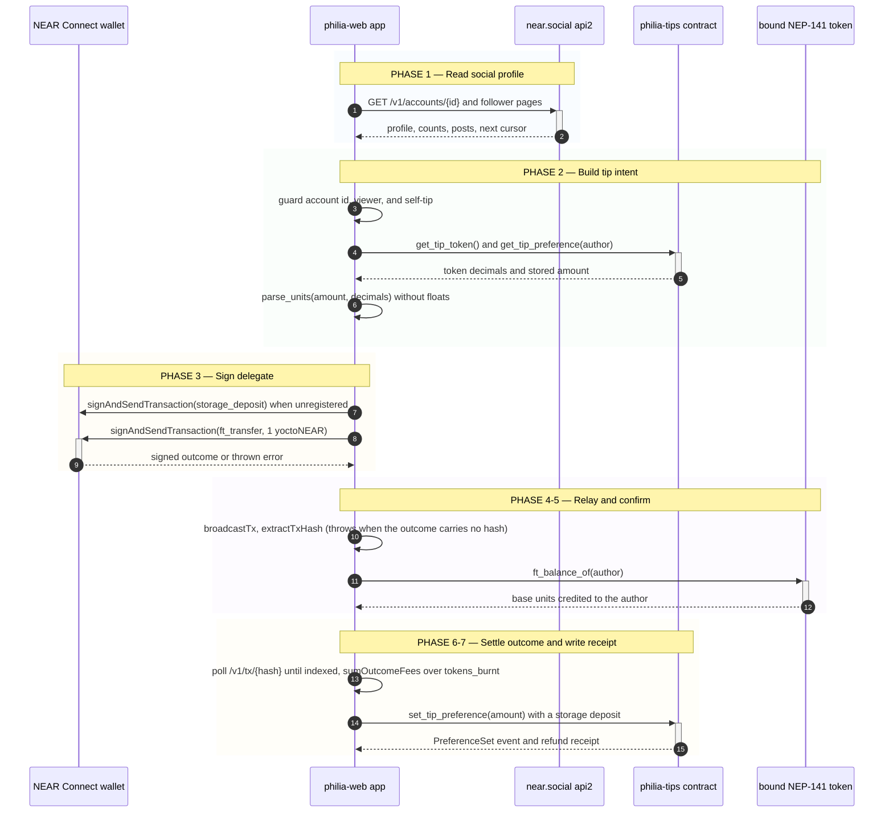

# philia — social on NEAR

Tracks: `social`, `open` (end 2026-11-14T23:59:00Z) · License: MIT ([LICENSE](./LICENSE)) · Baseline: tag `pre-hackathon` at `c716879` (SocialENS port); diff `git diff pre-hackathon..hackathon-submission`.


## What you can do
- Sign in with a named NEAR account (no email, password, or app record). Set a profile, publish posts, follow accounts, and read the global feed and follower lists.
## Architecture
| Layer | Design |
|---|---|
| Social primitive | **near.social social DB (`social-kv/1` FastData KV + SocialDB)** |
| Writes (mainnet) | `social.__fastdata_kv` (1 Tgas, zero deposit); keys `post/{id}`, `graph/follow/{account}`, `profile/*` |
| Reads (mainnet) | `api2.near.social` feeds, profiles, search, suggestions, follower lists, SSE stream; FastData `/v0/latest` and `/v0/multi` exact-key fallbacks |
| Writes/reads (testnet) | `v1.social08.testnet` via `near-social-js` reads and wallet-signed `set` writes |
| Media | FastFS upload to `social.__fastdata_fastfs` as `fastfs://{account}/social/{path}` |
| Tips | NEP-141 `ft_transfer` priced by the author's preference |
| Tip preferences | `philia-tips` (`tips.philia.testnet`): `LookupMap<AccountId, String>`, storage refunds, NEP-297 events |
| Wallet | NEAR Connect with a function-call access key for the two FastData methods |

`social` has no contract code. FastData calls return `CodeDoesNotExist` while the indexer records the valid write. philia treats that answer as success. It confirms the write via `GET /v1/tx/{hash}` (see [`CodeDoesNotExist` is success](#codedoesnotexist-is-success)). `philia-tips` binds one NEP-141 token (account and decimals). It validates amounts without floats, charges storage growth, refunds shrinks, and emits `PreferenceSet`, `PreferenceRemoved`, and `DefaultTipSet`.
## Repository layout
`contract/` (`philia-tips`: `units.rs`, `lib.rs`, sandbox tests) · `web/` (`philia-web`: Next.js app, social/tips/fastfs libraries) · `demo/` (zero-funds testnet loop, gas/latency and storage measurement) · `scripts/` (account creation and contract deployment) · `.env.example`.
## Quickstart
Prerequisites: Node.js >= 26.0.0, pnpm >= 12.18.0, Rust 1.100.0 (`wasm32-unknown-unknown`), `cargo-near` 0.23.0, and `near-cli-rs` 0.31.1. V8 14.6 ships `Uint8Array` base64/hex codecs and `Map.getOrInsert`, though the app uses a portable `Map` pattern.

```bash
# 1. Install JS workspaces (web + demo).
pnpm install
# 2. Configure the app (targets testnet and Circle testnet USDC).
cp .env.example web/.env.local
# 3. Create testnet accounts (top-level from faucet, sub-accounts from parent).
bash scripts/create-accounts.sh
# 4. Build and deploy the contract, then read the default tip.
bash scripts/deploy.sh
```

```bash
PHILIA_CONTRACT=tips.philia.testnet TIP_FT=wrap.testnet TIP_DECIMALS=24 bash scripts/deploy.sh
```

The zero-funds run used `tips.philia.testnet` (`ft_account_id=wrap.testnet`, `decimals=24`, 1 NEAR wrapped, `bob` registered). Demo `PHILIA_CONTRACT`, `TIP_FT`, and `NEXT_PUBLIC_PHILIA_CONTRACT` in `web/.env.local` must match `get_tip_token()`. A mismatch is a deployment error.

```bash
export ALICE_ACCOUNT=alice.philia.testnet
export ALICE_PRIVATE_KEY=...          # local keystore or wallet export
export BOB_ACCOUNT=bob.philia.testnet
export PHILIA_CONTRACT=philia.testnet
export TIP_FT=3e2210e1184b45b64c8a434c0a7e7b23cc04ea7eb7a6c3c32520d03d4afcb8af
export SOCIALDB_CONTRACT_ID=v1.social08.testnet
node demo/social-loop.mjs
```

```
done: a post indexed + a tip settled
```
The script fails fast on missing vars or mismatched network IDs. Afterward, run `pnpm dev` for the web UI and `demo/measure*.mjs` for gas, latency, and storage numbers (see [Numbers](#numbers)). Mainnet writes spend real funds; tips run only if `TIP_FT`, `BOB_ACCOUNT`, and `PHILIA_CONTRACT` are set:
```bash
PHILIA_NETWORK=mainnet ALICE_ACCOUNT=you.near ALICE_PRIVATE_KEY=... node demo/social-loop.mjs
```
## `CodeDoesNotExist` is success
1. Extract the transaction hash.
2. Poll `https://api2.near.social/v1/tx/{hash}` every 1.5 seconds.
3. Succeed only when `indexed` is `true` and every `actions[].keys[].status` is `ok`.

Key statuses `invalid`, `ignored`, `rate_limited`, `key_too_long`, or `value_too_large` fail the write. Action errors `too_many_keys`, `invalid_json`, or `invalid_borsh` fail it too. `/v1/tx` keeps ~200k transactions and reports stale hashes without retrying.

## NEP-413 authentication and replay
`web/lib/auth.ts` verifies signatures with `near-api-js/nep413` `verifyMessage`. It requires an on-chain `FullAccess` key. It also matches message, recipient, nonce, and callback URL. This repo has no backend store. Production backends MUST mint a 32-byte nonce per session and bind it. Accept each nonce once, check `recipient`, and reject replays.
## Limits and costs

| Limit | Value |
|---|---|
| Posts | 300 |
| Likes | 1,000 |
| Reposts | 300 |
| Follows | 5,000 |
| Uploaded media | 5 MiB |
| Keys per transaction | 256 |
| Key length | 1,024 bytes |
| Value size | 256 KiB |
| Transaction size | 1.5 MiB |

- **Costs:** named accounts cost 0.007 NEAR in gas for 770 bytes (extra bytes stake 1e19 yocto/B per NEP-448; `scripts/create-accounts.sh` faucets the parent and creates two sub-accounts at 0.1 NEAR); testnet SocialDB needs 0.02 NEAR storage (the demo attaches 0.05); tip-preference storage deposits for growth, costs 0 for equal-length updates, refunds shrinks, ~0.001–0.002 NEAR per ≤64-byte record (see `demo/measure-storage.mjs`).
- **Testnet vs mainnet:** testnet SocialDB (`v1.social08.testnet`) is not indexed by api2.near.social (there is no testnet api2 API); raw testnet FastData writes index at `kv.test.fastnear.com`; mainnet writes target `social` and `api2.near.social`; default testnet RPC is `https://rpc.testnet.fastnear.com` (override with `NEXT_PUBLIC_NEAR_RPC_URL` or `NEAR_RPC_URL`). Accounts are not unique humans, so daily quotas only bound per-account spam.
## Tip assets and fees

| Path | Asset | Decimals | Use |
|---|---|---|---|
| Production | Circle native USDC — mainnet `17208628f84f5d6ad33f0da3bbbeb27ffcb398eac501a31bd6ad2011e36133a1`, testnet `3e2210e1184b45b64c8a434c0a7e7b23cc04ea7eb7a6c3c32520d03d4afcb8af` | 6 | Mainnet, or testnet with Circle faucet USDC |
| Zero-funds fallback | `wrap.testnet` (wrapped NEAR) | 24 | Testnet without USDC (`near_deposit`) |
| Last resort | Self-deployed NEP-141 at `tip.philia.testnet` | deployment-defined | When neither above is usable |

For self-deployed FTs, deploy near-examples FT or `#[derive(FungibleToken)]` from `near-sdk-contract-tools`. Call `new_default_meta` and match decimals. `use-global-account-id` fails because global FT accounts have no code. Always use Circle native USDC (never bridged USDC.e), and read `get_tip_token()` rather than assuming 6 decimals. Check `storage_balance_of`. If it is `null`, attach the token's own `storage_balance_bounds.min`. Never hardcode `0.00125`, the `wrap.testnet` minimum only. For the `NEXT_PUBLIC_PHILIA_TIP_FT=wrap.testnet` fallback, run `deploy.sh` with `decimals=24`:

```bash
near call wrap.testnet near_deposit '{}' --deposit 1 --use-account alice.philia.testnet --network-id testnet
near call wrap.testnet storage_deposit '{"account_id":"bob.philia.testnet"}' --deposit 0.00125 --use-account alice.philia.testnet --network-id testnet
near call wrap.testnet ft_transfer '{"receiver_id":"bob.philia.testnet","amount":"1000000000000000000000000"}' --deposit-yocto 1 --use-account alice.philia.testnet --network-id testnet
```
Cross-chain tips use 1Click (`POST /v0/quote`, `destinationAsset` `nep141:17208628f84f5d6ad33f0da3bbbeb27ffcb398eac501a31bd6ad2011e36133a1`, `dry: true`). Fees are 25 bps unauthenticated, 20 bps authenticated (0.2%), and 1 bp for stablecoin pairs. Since 2026-10-27 1Click defaults to confidential swaps. So `GET /v0/status?depositAddress=…` `nearTxHashes` may show shield or unshield txs. These are not a public swap hash, and philia makes no privacy claim. Only `SUCCESS` succeeds. The terminal failures are `REFUNDED`, `FAILED`, and `INCOMPLETE_DEPOSIT`.
## Numbers

```bash
export NEAR_RPC_URL=https://rpc.testnet.fastnear.com
export ALICE_ACCOUNT=alice.philia.testnet ALICE_PRIVATE_KEY=...
node demo/measure.mjs
export PHILIA_CONTRACT=tips.philia.testnet BOB_ACCOUNT=bob.philia.testnet BOB_PRIVATE_KEY=...
node demo/measure-storage.mjs
export TIP_FT=wrap.testnet TIP_AMOUNT=0.001
node demo/measure-tip.mjs
```

- **`measure.mjs` (10/10):** ~1 KB FastData write burns 1.473364542367 Tgas / 0.0001250181979867 N (`tokens_burnt`). It reaches `FINAL` in 3,798 ms avg and testnet KV index in 3,958 ms avg. Protocol is 88, no function-call-key allowance was used, and `tx_status FINAL` already includes KV latency.
- **`measure-tip.mjs`:** 30 Tgas `ft_transfer` (1 yocto) burns 2.391197807527 Tgas / 0.000216801525 N (`FINAL` in 4.2 s and 3.9 s).
- **`measure-storage.mjs` (protocol 88):** storage costs 1e19 yocto/B. A 94-byte entry costs 0.00094 N (0.01024 N/KB). Equal-length updates cost 0 storage, and a 23-byte shrink refunds 0.00023 N (plus any excess 0.01 N deposit).

Testnet `social` writes return `AccountDoesNotExist` by design while KV still indexes them. `/v1/tx` is mainnet-only. All three scripts refuse mainnet and exit non-zero on unexpected errors.

## Claim → evidence
| Claim | Evidence |
|---|---|
| Tip amounts parse without floats, identically in contract and client | `contract/src/units.rs:37` (`parse_units`); `demo/test/near-rpc.test.mjs:12` (`parseUnits mirrors the contract parser`) |
| NEP-413 signatures verified, nonce/recipient/nonce binding enforced | `web/lib/auth.ts:152` (`verifyMessage`); `web/test/lib.test.mjs` (`auth nonce and payload keep the 32-byte guarantee and fail-fast validation`) |
| Tip confirmation extracts hashes from wallet, RPC, and failure shapes | `web/test/lib.test.mjs:260` (`extractTxHash extracts hashes from wallet, RPC, and nested failure shapes`) |
| Demo ends with a post indexed and a tip settled | `demo/social-loop.mjs:384` prints `done: a post indexed + a tip settled` |
| Contract behavior in sandbox | `contract/tests/test_basics.rs` (`cargo test`, Linux/macOS) |
| Gas, latency, and storage numbers | [Numbers](#numbers), produced by `demo/measure.mjs`, `demo/measure-storage.mjs`, `demo/measure-tip.mjs` |
| JS suite green | `pnpm test` → 24/24 pass, exit 0 (measured 2026-11-14) |

## Baseline and disclosure

Baseline: tag `pre-hackathon` marks the imported tree at `c716879` (SocialENS).
Submission: tag `hackathon-submission` marks the submitted state. `git rev-parse --short hackathon-submission` prints it.
Diff: `git diff pre-hackathon..hackathon-submission`. After publishing, `https://github.com/<owner>/<repo>/compare/pre-hackathon...hackathon-submission`.
Libraries, templates and AI-generated code are listed in `ATTRIBUTION.md` and `NOTICE`.
Q-015: the second project on the same submission email is **ekklesia** (agent market, tracks `swarms`, `agents`).
## Origin, license, and attribution
Port of **SocialENS** (MIT, `https://github.com/NikhilRaikwar/SocialENS`). It won ENS prize categories at ETHGlobal HackMoney 2026 (`https://ethglobal.com/showcase/socialens-jps0p`).

See [`LICENSE`](./LICENSE), [`ATTRIBUTION.md`](./ATTRIBUTION.md), and [`NOTICE`](./NOTICE) (Scaffold-ETH 2 baseline, with the EVM workspace deleted).
## Hackathon fit and constraints
- Avatars cap at 1 MiB (`Simple`). Larger media uses 1 MiB `Partial` chunks up to 32 MiB.
## Development commands
```bash
pnpm dev                          # web app
pnpm build                        # production build
pnpm lint                         # eslint .
pnpm check-types                  # tsc --noEmit
pnpm test                         # node --test: consolidated lib suite + demo near-rpc — 24/24 pass, exit 0 (measured 2026-11-14)
cd contract && cargo test --lib   # decimal parser unit tests
cd contract && cargo test         # sandbox integration test (Linux or macOS)
node demo/social-loop.mjs         # zero-funds testnet loop
node demo/measure.mjs             # gas, latency, protocol (testnet)
node demo/measure-storage.mjs     # tips-contract storage cost (testnet)
```

```bash
npx skills add near/agent-skills --skill near-smart-contracts --skill near-dapp --skill near-api-js --skill near-intents --skill near-kit
```

See [`CONTRIBUTING.md`](./CONTRIBUTING.md). Submission payload fields, deadline, video, and checklist rules live in [`SUBMISSION-PREP.md`](./SUBMISSION-PREP.md).
