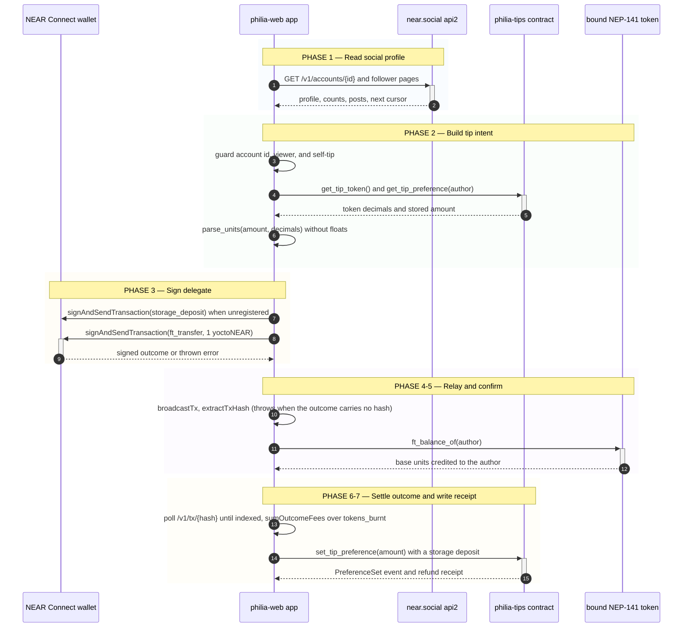

# philia

Tracks: `social`, `open` · MIT ([LICENSE](./LICENSE)) · Baseline: tag `pre-hackathon` at `c716879` (SocialENS port); `git diff pre-hackathon..hackathon-submission` · Q-015: the second project on the same email is **ekklesia** (agent market, tracks `swarms`, `agents`).

One signed transaction tips anyone on NEAR social: the wallet approves, the web app confirms, and a contract stores the preference while a bound NEP-141 token moves. Creators get paid where their audience already is, with no custody.



```bash
pnpm install && cp .env.example web/.env.local
bash scripts/create-accounts.sh && bash scripts/deploy.sh
pnpm dev
node demo/social-loop.mjs
pnpm test && (cd contract && cargo test)
```

| Do this | See this | Proves |
|---|---|---|
| `bash scripts/deploy.sh` | `tips.philia.testnet` with `TIP_FT=wrap.testnet` | quickstart |
| `node demo/social-loop.mjs` | post indexed, tip settled on chain | end-to-end tip |
| `pnpm dev` | profile read, tip sent from the UI | user flow |
| `pnpm test`; `cargo test` | 24/24 JS tests, sandbox suite green | tests |
| `node demo/measure-tip.mjs` | 2.39 Tgas / 0.000217 N per tip | cost |
| Limits | mainnet writes spend real funds; tips need `TIP_FT`, `BOB_ACCOUNT`, `PHILIA_CONTRACT` | honest scope |

[ATTRIBUTION.md](./ATTRIBUTION.md) · [LICENSE](./LICENSE)
