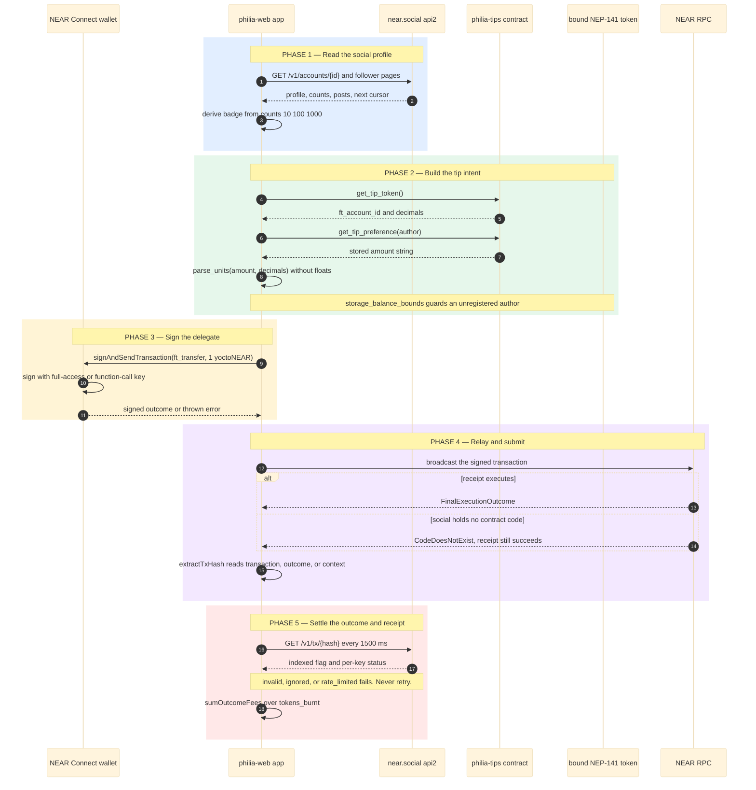

# philia — sovereign social on NEAR
philia is an on-chain social app. Profiles, posts, follow edges, and tip preferences live in NEAR-native storage. There is no application database or server-side account system. A named NEAR account is the identity, the wallet is the login, and the social graph is public data. The app ships a Rust tipping-preferences contract and a zero-funds testnet demo. The demo sets a profile and publishes a post. It follows an account, reads the feed and follower list, and settles a tip.


## What you can do
- Sign in with a named NEAR account (no email, password, or app record). Set a profile (display name, bio, FastFS avatar).
- Publish an append-only post on mainnet FastData, or store the latest main post on testnet SocialDB. Follow, unfollow, and read the global feed plus follower/following lists.
- View a client-derived reputation badge from indexer follower counts (≥10 / ≥100 / ≥1,000). Set a per-account tip preference and tip in the bound NEP-141 token.
- On mainnet FastData, confirm writes by hash via the indexer (showing any rejected keys). Testnet SocialDB writes return after submission because api2 is mainnet-only.
## Architecture
| Layer | Design |
|---|---|
| Social primitive | **near.social social DB (`social-kv/1` FastData KV + SocialDB)** |
| Writes (mainnet) | `social.__fastdata_kv` (1 Tgas, zero deposit); keys `post/{id}`, `graph/follow/{account}`, `profile/*` |
| Reads (mainnet) | `api2.near.social` feeds, profiles, search, suggestions, follower lists, SSE stream; FastData `/v0/latest` and `/v0/multi` exact-key fallbacks |
| Writes/reads (testnet) | `v1.social08.testnet` via `near-social-js` reads and wallet-signed `set` writes |
| Media | FastFS upload to `social.__fastdata_fastfs` as `fastfs://{account}/social/{path}` |
| Tips | NEP-141 `ft_transfer` priced by the author's preference |
| Tip preferences | `philia-tips` (`tips.philia.testnet`): `LookupMap<AccountId, String>`, storage refunds, NEP-297 events |
| Wallet | NEAR Connect with a function-call access key for the two FastData methods |

`social` has no contract code. FastData calls return `CodeDoesNotExist` while the indexer records the valid write. philia treats that answer as success. It confirms the write via `GET /v1/tx/{hash}` (see [`CodeDoesNotExist` is success](#codedoesnotexist-is-success)). `philia-tips` binds one NEP-141 token (account and decimals). It validates amounts without floats, charges storage growth, refunds shrinks, and emits `PreferenceSet`, `PreferenceRemoved`, and `DefaultTipSet`.
## Repository layout
```
near-philia/
├── contract/          # philia-tips: units.rs, lib.rs, sandbox tests
├── web/               # philia-web: Next.js app, social/tips/fastfs libraries
├── demo/              # zero-funds testnet loop + gas/latency and storage measurement
├── scripts/           # account creation and contract deployment
└── .env.example
```
## Quickstart
Prerequisites: Node.js >= 26.0.0, pnpm >= 12.18.0, Rust 1.100.0 (`wasm32-unknown-unknown`), `cargo-near` 0.23.0, and `near-cli-rs` 0.31.1. V8 14.6 ships `Uint8Array` base64/hex codecs and `Map.getOrInsert`, though the app uses a portable `Map` pattern.

```bash
# 1. Install JS workspaces (web + demo).
pnpm install
# 2. Configure the app (targets testnet and Circle testnet USDC).
cp .env.example web/.env.local
# 3. Create testnet accounts (top-level from faucet, sub-accounts from parent).
bash scripts/create-accounts.sh
# 4. Build and deploy the contract, then read the default tip.
bash scripts/deploy.sh
```

`scripts/deploy.sh` deploys to `PHILIA_CONTRACT` (`philia.testnet`). It passes `TIP_FT` (Circle testnet USDC, 6 decimals) and `TIP_DECIMALS` (6). This binds one token permanently. Override with:

```bash
PHILIA_CONTRACT=tips.philia.testnet TIP_FT=wrap.testnet TIP_DECIMALS=24 bash scripts/deploy.sh
```

The zero-funds run used `tips.philia.testnet` (`ft_account_id=wrap.testnet`, `decimals=24`, 1 NEAR wrapped, `bob` registered). Demo `PHILIA_CONTRACT`, `TIP_FT`, and `NEXT_PUBLIC_PHILIA_CONTRACT` in `web/.env.local` must match `get_tip_token()`. A mismatch is a deployment error.

5. Export demo keys in your shell (never commit keys, and fund `alice` with the bound token or wNEAR), then run:

```bash
export ALICE_ACCOUNT=alice.philia.testnet
export ALICE_PRIVATE_KEY=...          # local keystore or wallet export
export BOB_ACCOUNT=bob.philia.testnet
export PHILIA_CONTRACT=philia.testnet
export TIP_FT=3e2210e1184b45b64c8a434c0a7e7b23cc04ea7eb7a6c3c32520d03d4afcb8af
export SOCIALDB_CONTRACT_ID=v1.social08.testnet
node demo/social-loop.mjs
```
Expected final line (after profile, post, follow, feed/follower reads, and NEP-141 transfer hashes):

```
done: a post indexed + a tip settled
```
The script fails fast on missing vars or mismatched network IDs. Afterward, run `pnpm dev` for the web UI. Run `demo/measure.mjs` for gas and latency. Run `demo/measure-storage.mjs` for contract storage cost (see [Numbers](#numbers)). Mainnet writes spend real funds: `__fastdata_kv` to `social`, `/v1/tx` confirm, api2 reads. Tips run only if `TIP_FT`, `BOB_ACCOUNT`, and `PHILIA_CONTRACT` are set:
```bash
PHILIA_NETWORK=mainnet ALICE_ACCOUNT=you.near ALICE_PRIVATE_KEY=... node demo/social-loop.mjs
```
## `CodeDoesNotExist` is success
`social` holds no contract code, so `__fastdata_kv` returns `CodeDoesNotExist` while the receipt succeeds. Never retry:
1. Extract the transaction hash.
2. Poll `https://api2.near.social/v1/tx/{hash}` every 1.5 seconds.
3. Succeed only when `indexed` is `true` and every `actions[].keys[].status` is `ok`.

Key statuses `invalid`, `ignored`, `rate_limited`, `key_too_long`, or `value_too_large` fail the write. Action errors `too_many_keys`, `invalid_json`, or `invalid_borsh` fail it too. `/v1/tx` keeps ~200k transactions and reports stale hashes without retrying.

## NEP-413 authentication and replay
`web/lib/auth.ts` verifies signatures with `near-api-js/nep413` `verifyMessage`. It requires an on-chain `FullAccess` key. It also matches message, recipient, nonce, and callback URL. This repo has no backend store. Production backends MUST mint a 32-byte nonce per session and bind it. Accept each nonce once, check `recipient`, and reject replays.
## Limits and costs
FastData UTC-day quotas (over-quota writes return `rate_limited`):

| Limit | Value |
|---|---|
| Posts | 300 |
| Likes | 1,000 |
| Reposts | 300 |
| Follows | 5,000 |
| Uploaded media | 5 MiB |
| Keys per transaction | 256 |
| Key length | 1,024 bytes |
| Value size | 256 KiB |
| Transaction size | 1.5 MiB |

Edits and deletes keep public history. Avatars cap at 1 MiB per FastFS upload.

- **Account creation:** Named accounts cost 0.007 NEAR in gas (covers 770 bytes). Extra bytes stake 1e19 yocto/B per NEP-448. `scripts/create-accounts.sh` creates the parent from the faucet and two sub-accounts at 0.1 NEAR.
- **SocialDB (testnet demo):** `v1.social08.testnet` requires 0.02 NEAR (`storage_balance_bounds`). The demo attaches 0.05 NEAR, leaving the surplus in storage balance.
- **Tip-preference storage:** `set_tip_preference` deposits for growth, costs 0 for equal-length updates, and refunds shrinks. A ≤64-byte key + value + record costs ~0.001–0.002 NEAR at 1e19 yocto/B (≈0.01024 NEAR/KB). See `demo/measure-storage.mjs`.
- **Function-call key:** Signs zero-deposit `__fastdata_kv` and `__fastdata_fastfs` calls only. `ft_transfer` (1 yoctoNEAR) and `storage_deposit` always use wallet signing. Key allowance is not a spend limit.
- **Testnet vs mainnet:** Testnet SocialDB writes target `v1.social08.testnet` (not indexed by api2). Raw testnet FastData writes index at `kv.test.fastnear.com`. Mainnet writes target `social` and `api2.near.social`. `NEXT_PUBLIC_NEAR_NETWORK` picks the adapter. Default testnet RPC is `https://rpc.testnet.fastnear.com` (override with `NEXT_PUBLIC_NEAR_RPC_URL` or `NEAR_RPC_URL`). Accounts are not unique humans, so daily quotas only bound per-account spam.
## Tip assets and fees
Each `philia-tips` deployment binds one NEP-141 token (`ft_transfer`):

| Path | Asset | Decimals | Use |
|---|---|---|---|
| Production | Circle native USDC — mainnet `17208628f84f5d6ad33f0da3bbbeb27ffcb398eac501a31bd6ad2011e36133a1`, testnet `3e2210e1184b45b64c8a434c0a7e7b23cc04ea7eb7a6c3c32520d03d4afcb8af` | 6 | Mainnet, or testnet with Circle faucet USDC |
| Zero-funds fallback | `wrap.testnet` (wrapped NEAR) | 24 | Testnet without USDC (`near_deposit`) |
| Last resort | Self-deployed NEP-141 at `tip.philia.testnet` | deployment-defined | When neither above is usable |

For self-deployed FTs, deploy near-examples FT or `#[derive(FungibleToken)]` from `near-sdk-contract-tools`. Call `new_default_meta` and match decimals. `use-global-account-id` fails because global FT accounts have no code. Always use Circle native USDC (never bridged USDC.e), and read `get_tip_token()` rather than assuming 6 decimals. Check `storage_balance_of`. If it is `null`, attach the token's own `storage_balance_bounds.min`. Never hardcode `0.00125`, the `wrap.testnet` minimum only. For the `NEXT_PUBLIC_PHILIA_TIP_FT=wrap.testnet` fallback, run `deploy.sh` with `decimals=24`:

```bash
near call wrap.testnet near_deposit '{}' --deposit 1 --use-account alice.philia.testnet --network-id testnet
near call wrap.testnet storage_deposit '{"account_id":"bob.philia.testnet"}' --deposit 0.00125 --use-account alice.philia.testnet --network-id testnet
near call wrap.testnet ft_transfer '{"receiver_id":"bob.philia.testnet","amount":"1000000000000000000000000"}' --deposit-yocto 1 --use-account alice.philia.testnet --network-id testnet
```
Cross-chain tips use 1Click (`POST /v0/quote`, `destinationAsset` `nep141:17208628f84f5d6ad33f0da3bbbeb27ffcb398eac501a31bd6ad2011e36133a1`, `dry: true`). Fees are 25 bps unauthenticated, 20 bps authenticated (0.2%), and 1 bp for stablecoin pairs. Since 2026-10-27 1Click defaults to confidential swaps. So `GET /v0/status?depositAddress=…` `nearTxHashes` may show shield or unshield txs. These are not a public swap hash, and philia makes no privacy claim. Only `SUCCESS` succeeds. The terminal failures are `REFUNDED`, `FAILED`, and `INCOMPLETE_DEPOSIT`.
## Numbers
Reproduce on testnet (all runs protocol 88, 2026-11-12):

```bash
export NEAR_RPC_URL=https://rpc.testnet.fastnear.com
export ALICE_ACCOUNT=alice.philia.testnet ALICE_PRIVATE_KEY=...
node demo/measure.mjs
export PHILIA_CONTRACT=tips.philia.testnet BOB_ACCOUNT=bob.philia.testnet BOB_PRIVATE_KEY=...
node demo/measure-storage.mjs
export TIP_FT=wrap.testnet TIP_AMOUNT=0.001
node demo/measure-tip.mjs
```

- **`measure.mjs` (10/10):** ~1 KB FastData write burns 1.473364542367 Tgas / 0.0001250181979867 N (`tokens_burnt`). It reaches `FINAL` in 3,798 ms avg and testnet KV index in 3,958 ms avg. Protocol is 88, no function-call-key allowance was used, and `tx_status FINAL` already includes KV latency.
- **`measure-tip.mjs`:** 30 Tgas `ft_transfer` (1 yocto) burns 2.391197807527 Tgas / 0.000216801525 N (`FINAL` in 4.2 s and 3.9 s).
- **`measure-storage.mjs` (protocol 88):** storage costs 1e19 yocto/B. A 94-byte entry costs 0.00094 N (0.01024 N/KB). Equal-length updates cost 0 storage, and a 23-byte shrink refunds 0.00023 N (plus any excess 0.01 N deposit).

Testnet `social` writes return `AccountDoesNotExist` by design while KV still indexes them. `/v1/tx` is mainnet-only. All three scripts refuse mainnet and exit non-zero on unexpected errors.
## Origin, license, and attribution
Port of **SocialENS** (MIT, `https://github.com/NikhilRaikwar/SocialENS`). The origin ran from 2026-02-08 to 2026-03-14 and has 2 stars. It won ETHGlobal HackMoney 2026 at `https://ethglobal.com/showcase/socialens-jps0p`. Keeps the UI layer and rebuilds data, wallet, and payment layers, fixing four origin bugs:
- **Tip-preference key mismatch:** Profile wrote one record while readers read another, which fell back to `0.1`. philia uses `get_tip_preference(author)` as the one source of truth.
- **Dead follower count:** Origin read an unwritten record (always 0). philia reads `counts.followers` and `/v1/accounts/{id}/followers`.
- **20-cast cap / 20,000-block window:** Origin rewrote a 20-cast slice and scanned 20,000 blocks. philia writes append-only posts and reads full-history indexer feeds.
- **Asset mismatch:** Origin docs claimed ETH while transferring Sepolia USDC. philia uses NEP-141 only via `get_tip_token()`.

See [`LICENSE`](./LICENSE), [`ATTRIBUTION.md`](./ATTRIBUTION.md), and [`NOTICE`](./NOTICE) (Scaffold-ETH 2 baseline, with the EVM workspace deleted).
## Hackathon fit and constraints
Track: `social` (ends 2026-11-14T23:59:00Z). Uses neither SputnikDAO nor Trezu. It relies on named NEAR accounts, custom `philia-tips`, and client-derived follower tiers (≥10 / ≥100 / ≥1,000). Nothing is stored on-chain. The app reads `/v1/accounts/{id}`. No privacy layer, NFT wallet, or spend firewall.
- Testnet uses `v1.social08.testnet` / `near-social-js` / `kv.test.fastnear.com` (no `api2.near.social` testnet API). Function-call keys sign zero-deposit `__fastdata_kv` / `__fastdata_fastfs` only. Payable calls use wallet signing.
- Avatars cap at 1 MiB (`Simple`). Larger media uses 1 MiB `Partial` chunks up to 32 MiB.
## Before you submit (human-only)
No submission was made from this repo. Checklist for the human submitter:
- Send the 11-field payload without `website` (omit it, because an empty string is a spam trap). Set `tracks: ["social"]` (add another only if covered).
- Generate one fresh UUID `requestId` and reuse it on retries. Print the full JSON, read the contact notice, and send only after an explicit "yes".
- On 403, stop and tell the human (do not retry, reformat, or swap `requestId`). On 201, use `/request-changes` for fixes (never resubmit).
- X demo video ≤2 min, tagging **@NEARProtocol + #NEARHackathon**. Keep any optional host (Vercel Hobby, GitHub Pages, Netlify Free) live through Nov 18 (ideally Nov 25).
- Use WORKLOG numbers only once artifacts exist.
## Development commands
```bash
pnpm dev                          # web app
pnpm build                        # production build
pnpm lint                         # eslint .
pnpm check-types                  # tsc --noEmit
pnpm test                         # node --test: consolidated lib suite + demo near-rpc
cd contract && cargo test --lib   # decimal parser unit tests
cd contract && cargo test         # sandbox integration test (Linux or macOS)
node demo/social-loop.mjs         # zero-funds testnet loop
node demo/measure.mjs             # gas, latency, protocol (testnet)
node demo/measure-storage.mjs     # tips-contract storage cost (testnet)
```
Optional contributor skills:

```bash
npx skills add near/agent-skills --skill near-smart-contracts --skill near-dapp --skill near-api-js --skill near-intents --skill near-kit
```

See [`CONTRIBUTING.md`](./CONTRIBUTING.md).
